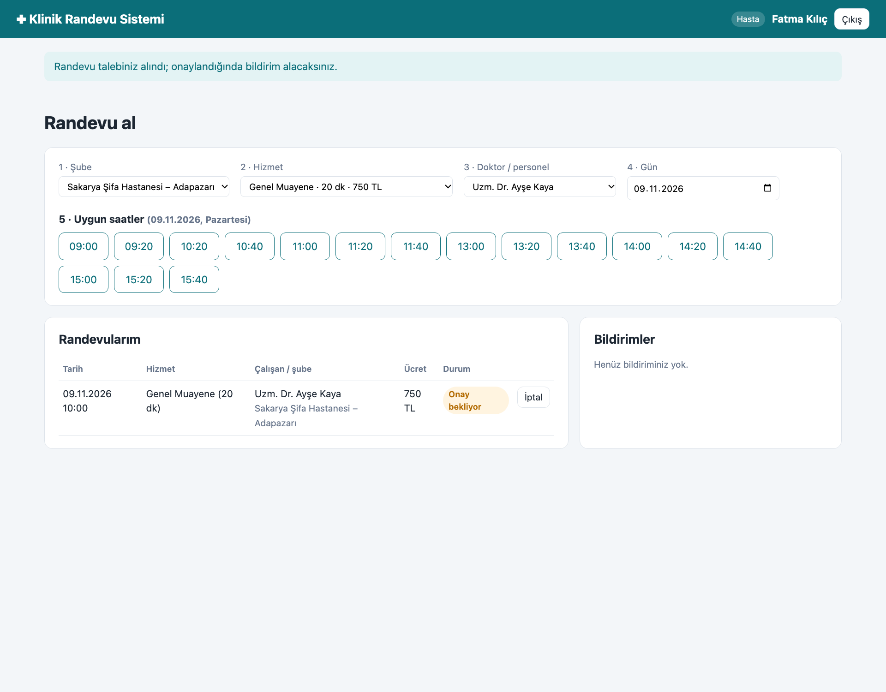
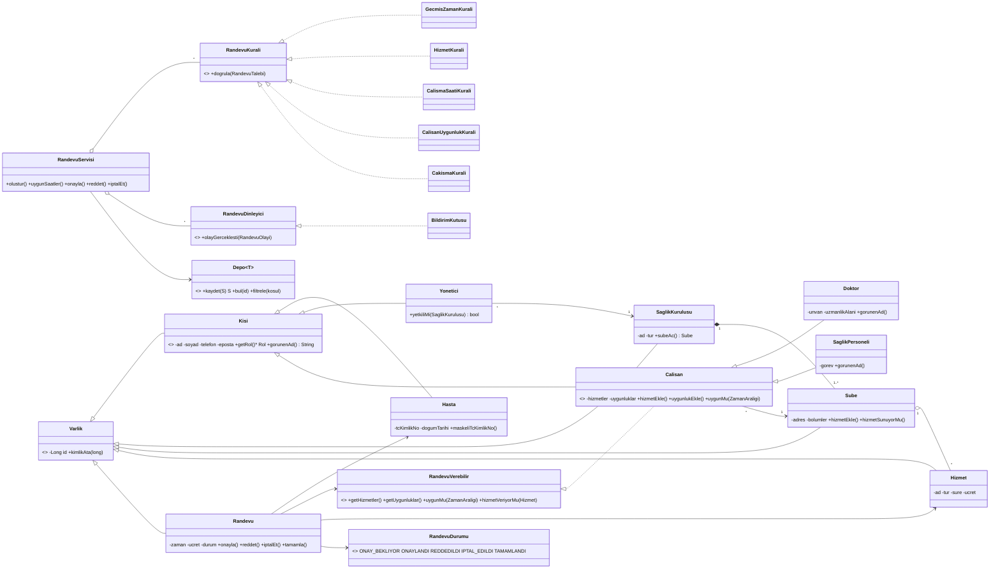
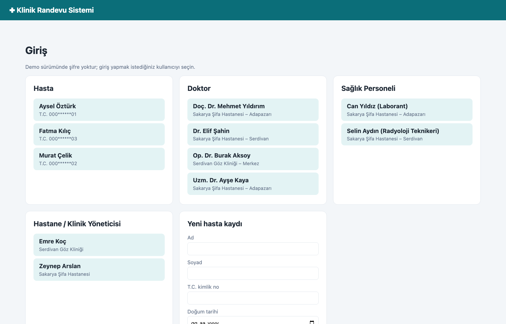
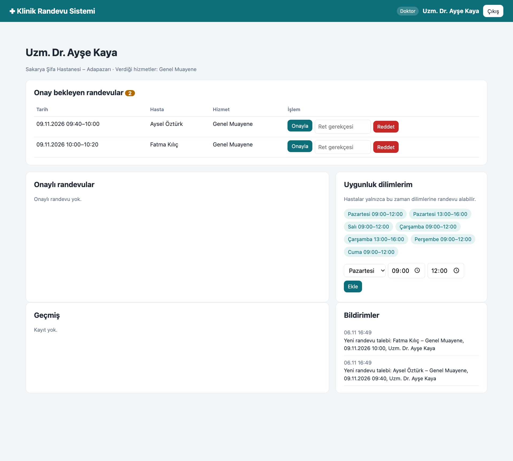

# Hastane / Klinik Randevu Sistemi

BSM515 Nesneye Dayalı Programlama Dilleri dersi proje ödevi (Seçenek A).
Sakarya Üniversitesi · Bilgisayar Mühendisliği Tezli Yüksek Lisans · Muhammed Oğur (Y195012002)

Tek şubeli bir klinik ya da çok şubeli bir hastane grubu için web tabanlı randevu sistemi. Java 21 ve
Spring Boot ile geliştirildi; amaç nesneye dayalı programlama ilkelerini (sınıf yapısı, kalıtım, çok
biçimlilik, kapsülleme, soyutlama) ve SOLID prensiplerini somut bir üründe göstermektir.



## Çalıştırma

Gereksinimler: Java 21+, Maven.

```bash
mvn spring-boot:run     # http://localhost:8081
mvn test                # 32 test (birim + web akışı)
```

Uygulama açılırken kurgusal örnek veri yüklenir: iki şubeli **Sakarya Şifa Hastanesi**, tek şubeli
**Serdivan Göz Kliniği**, doktorlar, sağlık personeli, yöneticiler ve hastalar. Giriş ekranında herhangi bir
kullanıcı seçilerek o rolle sisteme girilir (demo sürümde şifre yoktur). Yeni hasta kaydı da giriş ekranından yapılır.

## Gereksinimler ve karşılıkları

| Gereksinim (ödev belgesi) | Karşılayan sınıf(lar) / ekran |
|---|---|
| Hastane/klinik yetki çerçevesinde tanımlanır; tek ve çok şubeli yapı | `SaglikKurulusu`, `Sube`, `KurumServisi` · Yönetici ekranı |
| Çalışma saatleri ve bölümler | `CalismaSaatleri`, `Sube.bolumEkle` · Yönetici ekranı |
| Hizmetler: süre ve ücret | `Hizmet`, `HizmetTuru` · Yönetici ekranı |
| Doktor ve sağlık personeli kaydı, uzmanlık, sunduğu hizmetler | `Doktor`, `SaglikPersoneli`, `Calisan` · Yönetici ekranı |
| Uygunluk zaman dilimleri; hastalar yalnızca bu aralıklara randevu alır | `UygunlukDilimi`, `CalisanUygunlukKurali` · Çalışan ekranı |
| Uygun çalışan ve işlem seçerek randevu oluşturma | `RandevuServisi.uygunSaatler/olustur` · Hasta ekranı (şube → hizmet → çalışan → gün → saat) |
| Çakışma kontrolü | `CakismaKurali` (çalışan ve hasta için) |
| Randevu detayları (işlem, süre, ücret, çalışan, tarih/saat) | `Randevu` — oluşturulduğu anda sabitlenir |
| Onay mekanizması | `RandevuDurumu`, `RandevuServisi.onayla/reddet` · Çalışan ve yönetici ekranları |
| Roller: Hasta, Doktor / Sağlık Personeli, Yönetici | `Rol`, `Hasta`, `Calisan`, `Yonetici`, `Oturum` |
| *(Ek)* Yönetici raporu: şube/hizmet bazında randevu sayıları ve ciro | `RaporServisi` (Stream API, `groupingBy`) · Yönetici ekranı |

## Sınıf diyagramı



## Kullanılan NDP ilkeleri ve tasarım kalıpları

| İlke / kalıp | Projedeki karşılığı |
|---|---|
| **Kalıtım** | `Kisi → Calisan → Doktor / SaglikPersoneli`, tüm kayıtlar için `Varlik` ortak atası |
| **Soyutlama** | `Kisi`, `Calisan` soyut sınıflar; `getRol()` soyut metot |
| **Çok biçimlilik** | `gorunenAd()` her sınıfta farklı ("Uzm. Dr. Ayşe Kaya", "Can Yıldız (Laborant)"); randevu servisi Doktor ve Personeli ayırt etmeden `RandevuVerebilir` arayüzüyle çalışır |
| **Kapsülleme** | `Randevu`'nun durumu yalnızca `onayla()`, `reddet()`, `iptalEt()`, `tamamla()` ile ve kurallı geçişlerle değişir; koleksiyonlar dışarıya salt okunur verilir; şube yalnızca `SaglikKurulusu.subeAc()` ile oluşturulabilir; T.C. kimlik no yalnızca maskeli gösterilir |
| **Strategy + Open/Closed** | Her iş kuralı ayrı bir `RandevuKurali` sınıfı; yeni kural eklemek servisi değiştirmez |
| **Single Responsibility** | Geçmiş zaman, hizmet, çalışma saati, uygunluk ve çakışma kontrolleri ayrı sınıflarda |
| **Observer** | `RandevuDinleyici`; `BildirimKutusu` onay/ret/iptal bildirimlerini ilgili kişiye iletir |
| **Repository + Generics** | `Depo<T extends Varlik>`, `BellekDepo<T>`; `<S extends T> S kaydet(S)` alt türü korur |
| **Dependency Inversion / Injection** | Servisler depo, kural listesi ve saati (`Clock`) dışarıdan alır; alan sınıfları Spring'e bağımlı değildir, bağlantılar yalnızca `UygulamaYapilandirmasi`'nda kurulur |
| **Değer nesneleri** | `SaatAraligi`, `ZamanAraligi`, `UygunlukDilimi` (Java `record`, değişmez) |

## Randevu durumları

```
ONAY_BEKLIYOR ──onayla──▶ ONAYLANDI ──tamamla──▶ TAMAMLANDI
     ├──reddet──▶ REDDEDILDI      └──iptal──▶ IPTAL_EDILDI
     └──iptal───▶ IPTAL_EDILDI
```
Takvimde yalnızca "onay bekliyor" ve "onaylandı" durumundaki randevular yer tutar; reddedilen veya iptal
edilen randevunun saati yeniden alınabilir. Her durum değişikliği ilgili kişiye bildirim olarak düşer.

## Ekranlar

| Giriş | Çalışan (doktor) |
|---|---|
|  |  |

Yönetici ekranı: [docs/ekran-goruntuleri/04_yonetici.png](docs/ekran-goruntuleri/04_yonetici.png)

## Proje yapısı

```
src/main/java/tr/sau/randevu/
├─ model/kisi      Kisi, Hasta, Calisan, Doktor, SaglikPersoneli, Yonetici, RandevuVerebilir, Rol
├─ model/kurum     SaglikKurulusu, Sube, CalismaSaatleri, Hizmet, HizmetTuru
├─ model/randevu   Randevu, RandevuDurumu, ZamanAraligi, SaatAraligi, UygunlukDilimi
├─ kural           RandevuKurali ve 5 kural sınıfı
├─ servis          RandevuServisi, KurumServisi, RaporServisi
├─ olay            RandevuOlayi, RandevuDinleyici, BildirimKutusu
├─ depo            Depo<T>, BellekDepo<T>
├─ hata            RandevuHatasi, YetkiHatasi
├─ web             Oturum, GirisController, HastaController, CalisanController, YoneticiController
├─ UygulamaYapilandirmasi, OrnekVeri, RandevuUygulamasi
src/main/resources/templates   Thymeleaf sayfaları
src/test/java                  ModelTest, RandevuServisiTest, KurumServisiTest, RaporServisiTest, WebAkisTest
```

## Sınırlılıklar ve geliştirme fikirleri

- Veriler bellekte tutulur; uygulama kapanınca silinir (`Depo` arayüzü sayesinde JPA/H2 deposu eklenebilir).
- Giriş demo amaçlıdır; gerçek kullanımda Spring Security ile kimlik doğrulama gerekir.
- Bildirimler uygulama içidir; e-posta/SMS için yeni bir `RandevuDinleyici` yazmak yeterlidir.
